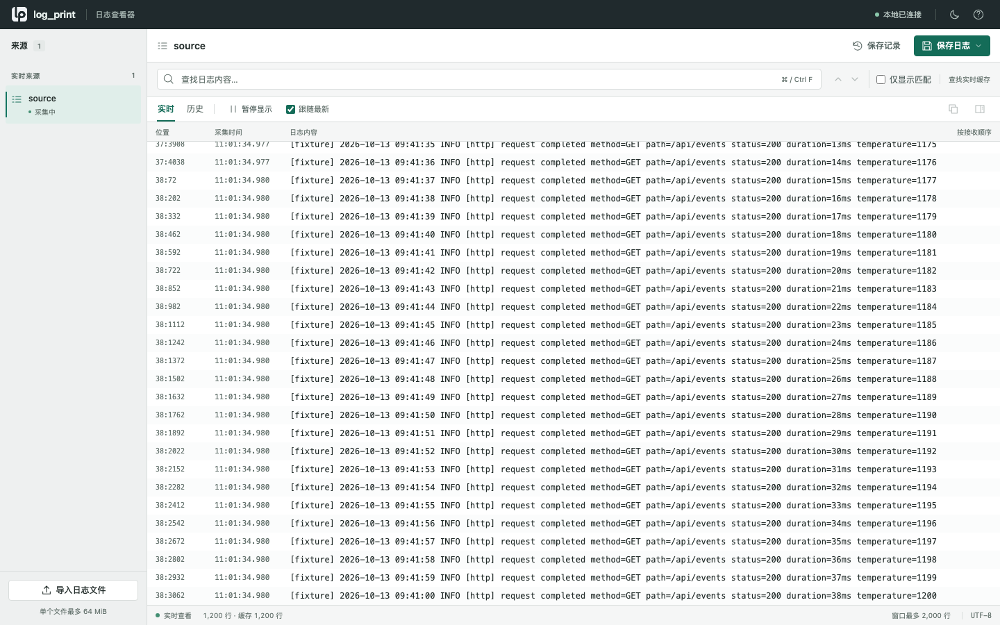

# output-webui：本地日志查看器 {#output-webui}

Vue 前端与 Rust 后端组成单一日志阅读界面。运行无需 Node、CDN 或互联网。来源选择、暂停、筛选、定位与保存都围绕同一条日志流完成。



截图来自真实服务，内容为明确标记的测试日志。

## 启动 {#start}

```sh
# 导入静态文件
log-print start --output-webui web
log-print webui web url

# 持续跟随文件，并启用完整归档
log-print start --input-file source=./app.log --output-webui web --webui-archive web=./capture
```

不启用归档时，只能读取当前保留的缓存。`--webui-archive` 创建本次运行的新 SQLite 归档；也可用 `--output-sqlite archive=./capture/run.sqlite --webui-history web=archive` 绑定同实例已有 output-file 配置。两种参数互斥，已有文件不会被覆盖。

## 阅读日志 {#read}

左侧选择实时来源或导入文件。顶部切换实时/历史：实时窗口最多显示 2,000 行；历史固定查询当前可读范围，每页最多 200 行。

- **暂停显示**：停止刷新当前内容，后台采集与保存继续。滚动离开末尾后，“回到最新”恢复跟随。
- **查找与筛选**：关键词按字面高亮；“仅显示匹配”过滤内容。Enter/Shift Enter 在当前窗口或当前历史页定位匹配，历史范围的过滤由 Rust 查询完成。
- **日志详情**：点击行后打开详情，可复制原文、查看来源、记录序号、字节偏移和通道；“读取前后 8 行”恢复筛选之外的上下文。
- **时间语义**：表格显示采集时间，正文中的来源时间保持原文。位置是记录序号与字节偏移，一个传输 Record 不一定是一行。
- **覆盖边界**：缓存覆盖、归档故障和缺口明确提示。正在显示不等于已经保存；已被所有存储丢弃的数据无法恢复。

## 文件导入 {#import}

点击“导入日志文件”或把一个文件拖入页面。支持最多 64 MiB，需要 TCP supervisor。文件通过独立 input-file → Core → Output 处理，并按持久化检查点限制在途数据。源 EOF、输出字节数和缺口状态共同确认完成。

每个导入文件都有自己的流，完成后自动进入历史视图；大于实时缓存的内容仍可查询。失败保留上传原件并显示原因。UTF-8 是当前展示方式，原始保存不修改字节。

## 持续保存 {#record}

“保存日志”让用户选择起点：

| 起点 | 行为 |
| --- | --- |
| 从现在开始保存 | 固定后端收到操作时的 Core head，保存后续原始日志 |
| 从最早可用数据保存 | 合并可读归档、WebUI 与 Core 缓存，去重补入历史，继续保存新增内容 |

在“保存记录”里查看状态、数据量和来源。点击“停止并保存”后排空到停止水位并提交；成功后可下载 `.log` 或查看本机文件路径。筛选和暂停不影响保存内容，缺口不会被标成完整历史。

文件位于 WebUI 状态目录 `recordings/<UUID>/`。文件保留在磁盘；运行内列表和导入流不在 supervisor 重启后自动重建。最多同时 4 个保存任务，每轮最多 64 个任务/导入流。

## 快捷键与小屏幕 {#keyboard}

| 快捷键 | 操作 |
| --- | --- |
| Ctrl/Cmd F | 聚焦查找 |
| Enter / Shift Enter（搜索框内） | 下一个 / 上一个匹配 |
| ↑ / ↓、PageUp / PageDown、Home / End（日志列表内） | 选择与定位日志 |
| Enter（日志列表内） | 查看所选日志详情 |
| Space（非输入控件内） | 暂停 / 继续显示 |
| Esc | 关闭浮层 |
| ? | 打开帮助 |

手机来源栏和详情以抽屉显示，保存记录从底部展开；长行只在日志区域横向滚动。浅/深色主题和选中来源保存在本浏览器。过滤词和当前选中行属于本次查看状态，不在刷新后恢复。

## CLI 与后端接口 {#cli}

```sh
log-print webui web streams
log-print webui web history read --stream source
log-print webui web history search --stream source --regex '^ERROR'
log-print webui web history context --stream source --epoch EPOCH --seq 123 --byte-offset 20 --before 8 --after 8
log-print webui web query get --query QUERY_UUID --offset 0 --limit 200
```

查询结果使用固定任务 ID 分页。HTTP 使用 `POST /api/control`；`logs.tail` 支持 stream/text/limit/since，`recording.start` 接受 stream 与 mode（now/earliest），`recording.stop` 接受 id。

旧工作台前端、画布/图表组件和备用入口已移除。CLI/TUI 继续使用共享 Rust 查询与配置引擎，当前浏览器查看状态独立。写请求验证 Host/Origin，凭据不进入浏览器。
